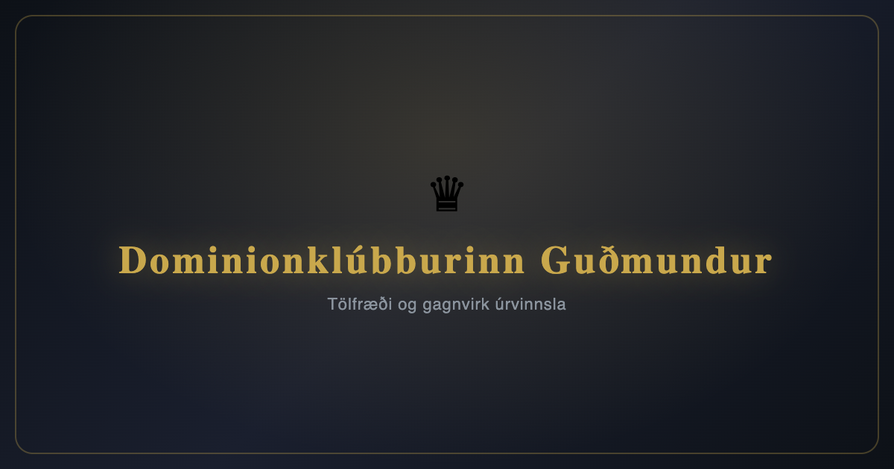

# ♛ Dominionklúbburinn Guðmundur

**[dominion.arnlaugsson.info](https://dominion.arnlaugsson.info)**

Tölfræði og gagnvirk úrvinnsla fyrir Dominionklúbbinn Guðmund. An interactive statistics dashboard for our [Dominion](https://boardgamegeek.com/boardgame/36218/dominion) board game club.



## Features

- **Dashboard**: club stats, random card of the day, player of the day
- **Players**: win rates, head-to-head records, score trends
- **Games**: full history with searchable game details, kingdom cards, results
- **Cards**: browse all cards with usage stats, filter by expansion and type
- **Fun Facts**: longest win streaks, highest scores, rivalries, and more
- **Árið**: a Wrapped-style year in review for the club and every player
- **Skill rating**: OpenSkill ratings that handle multiplayer games, ties and teams
- **Kingdom Suggester**: generate balanced kingdoms from your owned expansions

## Data Pipeline

Game data lives in a [Google Spreadsheet](https://docs.google.com/spreadsheets/d/14f5TW05_jpnWGf6d3cAO7ChSrHPZl0dIbxyIO3qqe2A) maintained by the club. A GitHub Actions workflow syncs it automatically:

1. Downloads the spreadsheet as XLSX every 2 hours
2. Parses all games with `openpyxl` (`scripts/sync_spreadsheet.py` + `scripts/sheet_sync/`), normalizing player, card, expansion and location names
3. Writes `data/dominion_data.json`, only when the data actually changed
4. Commits changes and deploys to Firebase Hosting

The JSON is served as `/data/dominion_data.json` (not bundled into the JS), so a data sync doesn't invalidate the browser's cached app code.

### Teams

When 2+ people play as one seat, write them on the same row of the **Sæti** scores block (partner in the column next to the name, shared score in the score column), or as `Mummi & Halla` in one cell. Each game in the JSON has a `seats` array (one entry per seat, solo players included) and team members get `teammates` in `results`.

### Skill rating

Ratings use [OpenSkill](https://openskill.me) (Weng-Lin / Plackett-Luce, `src/lib/ratings.js`). Every seat — a solo player or a team — is one competitor ranked by its place. A team is rated as one player of its members' average skill (OpenSkill's default would add them up), and every member moves by the same amount. The number shown is `1000 + 40 × (μ − 25)`: everyone starts at 1000 and it only moves with results. Players with fewer than 5 games are marked provisional and listed last. The game modal shows each player's rating change and every seat's pre-game win odds.

### Card images

Card scans live in Firebase Storage (`cards/{Name}.jpg`, ~700 KB). Grids use small WebP thumbnails (`cards-thumb/{Name}.webp`, ~35 KB) and fall back to the original if a thumbnail is missing. After adding new card scans, regenerate thumbnails with `scripts/make_card_thumbs.py` (see the usage notes at the top of the script).

Code changes pushed to `main` also trigger a build and deploy.

## Tech Stack

- **Frontend**: React 18, Vite 8, Chart.js
- **Tests**: Vitest + Testing Library (`npm test`), Python unittest for the sync
- **Hosting**: Firebase Hosting
- **Data sync**: Python 3 + openpyxl, GitHub Actions
- **CI/CD**: GitHub Actions (cron sync + push deploy)

## Browser support

The app uses top-level `await` to load its data (ES2022), so it needs Safari/iOS 15+, Chrome/Edge 89+ or Firefox 89+.

## Development

```bash
npm install
npm run dev
```

Run the tests:

```bash
npm test                                                   # frontend
for f in scripts/test_sync_*.py; do python3 "$f"; done     # sync script
```

To sync data locally from the spreadsheet:

```bash
pip install openpyxl
python3 scripts/sync_spreadsheet.py
```

## License

A private project for the Guðmundur Dominion club.
